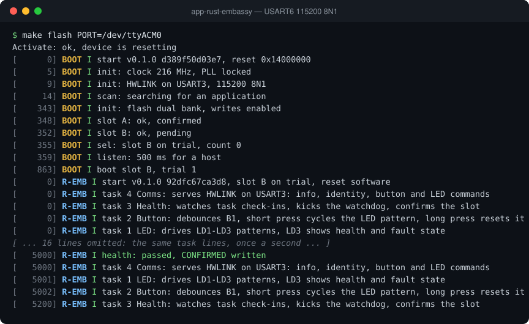

# app-rust-embassy

The NUCLEO-F767ZI demo application written in Rust on the Embassy async framework. It runs under the A/B bootloader from either slot and does exactly the same job as the C FreeRTOS demo: LED patterns, the user button, HWLINK communication with the desktop GUI, watchdog supervision and self-confirmation after a health check. It shows how a safe, allocation-free Rust application can live inside an existing C bootloader and toolchain ecosystem, and lets you compare Rust and C side by side on the same hardware.

## Debug terminal

The debug log from a reset on a NUCLEO-F767ZI (USART6, 115200 8N1), recorded from the board. [Watch it replay line by line](https://soccentric-stm32.github.io/#rust-embassy) on the project page.



<details>
<summary>Plain text</summary>

```console
$ make flash PORT=/dev/ttyACM0
Activate: ok, device is resetting
[      0] BOOT I start v0.1.0 d389f50d03e7, reset 0x14000000
[      5] BOOT I init: clock 216 MHz, PLL locked
[      9] BOOT I init: HWLINK on USART3, 115200 8N1
[     14] BOOT I scan: searching for an application
[    343] BOOT I init: flash dual bank, writes enabled
[    348] BOOT I slot A: ok, confirmed
[    352] BOOT I slot B: ok, pending
[    355] BOOT I sel: slot B on trial, count 0
[    359] BOOT I listen: 500 ms for a host
[    863] BOOT I boot slot B, trial 1
[      0] R-EMB I start v0.1.0 92dfc67ca3d8, slot B on trial, reset software
[      0] R-EMB I task 4 Comms: serves HWLINK on USART3: info, identity, button and LED commands
[      0] R-EMB I task 3 Health: watches task check-ins, kicks the watchdog, confirms the slot
[      0] R-EMB I task 2 Button: debounces B1, short press cycles the LED pattern, long press resets it
[      0] R-EMB I task 1 LED: drives LD1-LD3 patterns, LD3 shows health and fault state
[ ... 16 lines omitted: the same task lines, once a second ... ]
[   5000] R-EMB I health: passed, CONFIRMED written
[   5000] R-EMB I task 4 Comms: serves HWLINK on USART3: info, identity, button and LED commands
[   5001] R-EMB I task 1 LED: drives LD1-LD3 patterns, LD3 shows health and fault state
[   5002] R-EMB I task 2 Button: debounces B1, short press cycles the LED pattern, long press resets it
[   5200] R-EMB I task 3 Health: watches task check-ins, kicks the watchdog, confirms the slot
```

</details>

## Features

- Pure Rust (`no_std`, no allocator) on the Embassy async executor
- Runs from either bootloader slot, linked at `0x0800C000`
- Four async tasks: health, comms, button and LED
- Seven LED patterns on LD1/LD2 with LD3 reserved for faults
- B1 button with EXTI, 30 ms debounce and short/long press actions
- HWLINK over USART3 at 115200 or 921600 baud
- Fixed-buffer FlatBuffers codec, verified against the reference encoder
- COBS framing and CRC-32 shared with the C implementations
- Health task supervises check-ins and is the only watchdog feeder
- CONFIRMED record written after the trial health check
- Fault record in a reserved no-init RAM window that survives every reset
- Unsolicited ButtonEvent messages
- Crate versions locked in `Cargo.lock`
- Produces a ready-to-flash bootloader image (`embassy-app.img`)
- Reproducible Docker build environment with the pinned Rust toolchain

## Layout

| Path | Contents |
|---|---|
| `src/main.rs` | Entry point: clocks, caches, watchdog and task wiring |
| `src/app/` | The four Embassy tasks: `health`, `comms`, `button` and `led` |
| `src/board/` | MCU and board layer: constants, clock tree, bootloader hand-over, fault handler, factory identity |
| `src/system/` | Runtime services: IPC channels, logging and build metadata |
| `src/protocol/` | HWLINK codec: COBS framing, CRC-32 and the fixed-buffer FlatBuffers codec |
| `protocol/` | Shared `hwlink.fbs` schema |
| `linker/` | `memory.x` and `noinit.x` linker scripts |
| `scripts/` | Host build, container, serial and image tools |
| `ci/`, `docker/` | CI packaging and the reproducible build image |

## Build and run

```bash
scripts/docker-dev.sh build   # build the stm32-dev-rust container image once
scripts/build.sh              # build inside the container
make flash                    # upload build/embassy-app.img through the bootloader
make help                     # list all targets
```

## Related projects

- [bootloader](https://github.com/soccentric-stm32/bootloader) — A/B bootloader with UART update, CRC32 checks, trial boot and rollback
- [app-c-freertos](https://github.com/soccentric-stm32/app-c-freertos) — Demo application in C on FreeRTOS
- [app-c-zephyr](https://github.com/soccentric-stm32/app-c-zephyr) — Demo application in C on Zephyr RTOS
- [app-rust-zephyr](https://github.com/soccentric-stm32/app-rust-zephyr) — Demo application in Rust on Zephyr RTOS
- [validation-firmware](https://github.com/soccentric-stm32/validation-firmware) — HWVAL hardware validation firmware
- [validation-gui](https://github.com/soccentric-stm32/validation-gui) — HWVAL Studio: desktop GUI for tests, updates and flashing
- [factory-station](https://github.com/soccentric-stm32/factory-station) — HWVAL Factory: end-of-line test and provisioning station
- [soccentric-stm32.github.io](https://github.com/soccentric-stm32/soccentric-stm32.github.io) — Project website

## License

Released under the [MIT License](LICENSE) © 2026 Sandesh Ghimire. You are free
to use, modify and ship it in your own products.

Contributions are welcome. Fork the repository, make your change on a branch and
open a pull request. Bug reports, ideas and improvements are all appreciated.
